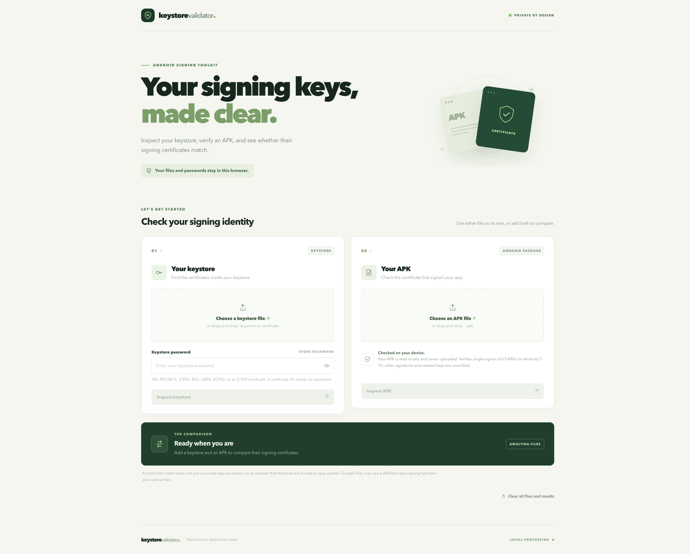

# Keystore Validator

A browser-local tool for inspecting Android signing certificates. It reads signing keystores, public certificates and APKs on your device, shows SHA-256 and SHA-1 fingerprints, and compares a selected certificate with an APK's verified signer. Files, passwords and results are not uploaded or stored by the application.

**Website:** [keystore-validator.vercel.app](https://keystore-validator.vercel.app/)



## How to use

1. Select a keystore or X.509 certificate and enter the store password if needed.
2. Select a certificate alias, then inspect an APK to compare its signer.
3. Review the fingerprints, verification status, and any compatibility warnings.

Both files are optional; either can be inspected on its own. Processing runs in browser workers, with no account or backend required.

## Run locally

Requires Node.js 22.12 or newer and npm.

```sh
npm ci
npm run dev
```

Open the URL printed by Vite. For a production-style local preview:

```sh
npm run build
npm run preview
```

`npm run build` uses the included, checksum-checked WASM assets, so Go is not required on Vercel. If the engine source changes, rebuild those assets with Go 1.24 or newer using `npm run build:wasm`, then include the updated files under `public/` with your changes. The current assets were built with Go 1.27.4.

Vercel can build this as a Vite project using `npm run build` and the `dist` output directory. The static security headers are configured in `vercel.json`; local preview uses those same headers. `.vercelignore` excludes common signing files from CLI uploads and restricts the deployment inputs. No server function or environment variable is required.

## Supported inputs and limits

- **Keystore:** JKS, PKCS#12/PFX, JCEKS, BKS, UBER, and standard password-MAC protected BCFKS, up to 16 MiB. Common modern and legacy PKCS#12 encryption is supported. Individual protected private-key entries are not decrypted; the store password is used to open and check the container. Older BKS v0/v1 stores have weak integrity and receive a warning.
- **Public certificate:** X.509 PEM or DER certificates can be inspected without a password. For APKs signed with a separate PKCS#8 private key and X.509 certificate, select the certificate; a private key alone does not contain a certificate fingerprint.
- **Provider limits:** PKCS#11 and hardware-backed keys require their provider or device; export their public X.509 certificate to compare it locally. Nonstandard provider formats, JCEKS stores containing serialized secret-key entries, older UBER variants, and uncommon BCFKS protection variants are not yet supported. BCFKS currently accepts PBKDF2 with HMAC-SHA-512 or HMAC-SHA3-512, or bounded scrypt, with AES-256-CCM.
- **APK:** up to 1 GiB. Cryptographic verification currently covers single-signer v2/v3 APKs for Android API 24–35. v1-only signatures, v3.1/rotated keys, multiple signers and unsupported algorithms are reported as unverified. For v1-only APKs, an embedded certificate fingerprint may be displayed for diagnostics; it is not a verified signer.
- **Comparison:** SHA-256 identifies the certificate. SHA-1 is included for compatibility with Android tooling. A match does not prove Android update compatibility, and Google Play's app-signing key can differ from the upload key.

The app processes data locally, but the site code served by the host and the user's browser remain part of the trust boundary. Do not add actual keystores, private keys, passwords, APKs or generated fixture keys to the repository.

## Tests

```sh
npm test                 # Go unit tests
npm run test:integration # disposable keystore/APK fixtures compared with keytool and apksigner
BKS_BCPROV_JAR=/path/to/bcprov.jar npm run test:bouncycastle # BKS, UBER and BCFKS fixtures
KV_TEST_LARGE=1 npm run test:integration # also exercise a 100+ MiB APK
```

Integration tests require Go, Java `keytool`, Python 3 and an Android SDK containing `aapt2`, `apksigner` and a platform `android.jar`. Set `ANDROID_SDK_ROOT` or `ANDROID_HOME` if it is not in the standard macOS or Linux location. Bouncy Castle tests additionally require a local bcprov JAR. Fixtures are generated in a temporary directory and deleted afterward.

Third-party licenses and notices are included under [public/licenses](public/licenses). The original [ProjectForge kickoff](keystore-validator-kickoff.md) and [signing research](research/signing-engine-findings.md) document the initial requirements and experiments; current behavior and limitations are described above.
