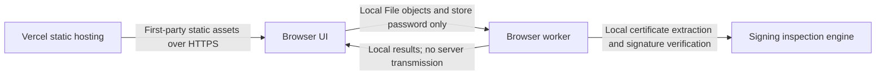
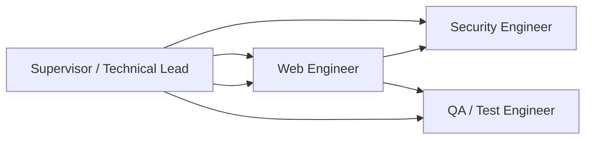

# Keystore Validator

**Kickoff status:** needs\_input

## Overview

A privacy-first browser application for inspecting Android signing certificates and comparing an APK signer with a keystore certificate.

**Project ID:** keystore-validator

**Classification:** web\_app

**Readiness:** needs\_input

- readiness.status cannot be 'ready' until the proposed team is accepted
- required decision 'engine' is pending
- required decision 'api-range' is pending
- required capability 'qa-test-engineer': 'automation' is partially\_verified (discovery: unverified)
- required capability 'qa-test-engineer': 'quality assurance' is partially\_verified (discovery: unverified)
- required capability 'qa-test-engineer': 'device and browser matrix' is partially\_verified (discovery: unverified)
- required capability 'qa-test-engineer': 'CI reporting' is partially\_verified (discovery: unverified)
- required capability 'security-engineer': 'Threat modeling tools' is partially\_verified (discovery: unverified)
- required capability 'security-engineer': 'dependency and code scanning tools' is partially\_verified (discovery: unverified)
- required capability 'web-engineer': 'web frontend engineering' is partially\_verified (discovery: unverified)
- required capability 'web-engineer': 'browser compatibility' is partially\_verified (discovery: partial)
- required capability 'web-engineer': 'Browser devtools' is partially\_verified (discovery: unverified)
- required capability 'web-engineer': 'frontend build and test tools' is partially\_verified (discovery: unverified)

---

## Goals and scope

### Goals
- Read and display signing certificate fingerprints from a supplied JKS keystore.
- Inspect an APK signature and compare its verified signing certificate with a selected keystore certificate.
- Keep APKs, keystores, private keys, and passwords in the browser while hosting the application on a Vercel Hobby account.

### Included
- Browser-local JKS inspection and alias selection
- Browser-local APK signing certificate inspection and signature verification
- SHA-256 certificate comparison with clear match, mismatch and unverifiable outcomes
- Hobby-compatible static deployment and privacy-focused user experience

### Excluded
- Signing or modifying APKs
- Uploading files, passwords, or private keys
- Account creation, database, server-side file handling, or long-term storage
- AAB inspection and Play Console integration for the initial release
- Claiming APK install/update compatibility merely from matching a certificate

---

## Discovery record

**Mode:** standard

| Topic | Value | Evidence status | Source | Rationale |
| --- | --- | --- | --- | --- |
| Purpose | Extract JKS and APK signing certificate fingerprints and compare them. | confirmed | User project request | Not specified |
| Sensitive processing | Process JKS and APK files in the browser. Do not transmit private keys, files or passwords. | confirmed | User discovery replies and follow-up | Not specified |
| APK size | Support APKs of at least 100 MB. | confirmed | User discovery reply | Not specified |
| Hosting | Deploy to a Hobby Vercel account. | confirmed | User project request | Not specified |
| Language preference | Python preferred; other languages may be proposed. | confirmed | User project request | Not specified |
| Existing code | The workspace was initially empty and not a Git repository. | verified | Local workspace inspection | Not specified |
| Vercel function limit | Vercel Functions impose a 4.5 MB request or response body limit. | verified | https://vercel.com/docs/functions/limitations | Not specified |
| Privacy architecture | Serve static assets from Vercel and process all selected files locally; comparison needs no server. | recommended | Architecture synthesis | Not specified |

---

## Audience and platforms

### Audience
- Android developers and release engineers

### Platforms
- Modern desktop web browsers
- Vercel static hosting

### Identifiers
- Not specified

---

## Technology

### Preferences
- Python for development where appropriate; user explicitly permits an alternative.

### Selected
- TypeScript browser application (recommended working choice)
- Web Workers and browser File/Blob APIs (design recommendation)
- WebAssembly verifier only if the feasibility and security gates pass
- Vercel static hosting

### Alternatives
- Python server: rejected for file handling because it would violate browser-local processing and server request size limits.
- Python local scripts: optional for fixture generation or cross-checks; not a production file-processing backend.
- Investigate Go/WASM plus TypeScript: a JKS alias/certificate experiment succeeded under Node, but browser and APK-verification gates remain open.

### Compatibility evidence
| Finding | Status | Source |
| --- | --- | --- |
| The Vercel function body limit makes typical large APK uploads unsuitable; static browser processing avoids the function upload path. | verified | https://vercel.com/docs/functions/limitations |
| apksig-go advertises v1/v2/v3/v3.1 support and a browser WASM API; its browser integration copies the complete APK into Go memory and its correctness and size limits have not been verified here. | pending | https://github.com/agusibrahim/apksig-go |
| A browser JKS library that verifies store integrity and lists certificate aliases without decrypting private keys has not yet been validated. | pending | https://github.com/lenchv/jks-js |
| A generated JKS was inspected with keystore-go v4.5.0 compiled to Go/WASM and executed under Node. The alias and certificate SHA-256 matched keytool; a wrong store password failed. This is a narrow proof, not a browser, malformed-input or APK verifier test. | verified | Local generated fixture: Go 1.27.4, Node 26.13.1, keytool; keystore-go https://github.com/pavlo-v-chernykh/keystore-go |
| A narrow Node/WASM differential experiment with apksig-go v1.1.0 and AOSP golden APKs found a disagreement on a valid v2-only APK: apksigner verifies it for API 24-35, while the candidate rejects it based on manifest minSdk 23. A tampered v1/v2/v3 APK was rejected overall by both, but individual signer verified flags remained true in the candidate. This is not a browser or security audit. | verified | AOSP golden fixtures https://android.googlesource.com/platform/tools/apksig/+/refs/heads/main/src/test/resources/com/android/apksig/ and local Android SDK build-tools 37.0.0 apksigner |

---

## Features

| Feature | Priority | Status | Description | Acceptance criteria | Depends on |
| --- | --- | --- | --- | --- | --- |
| Inspect a keystore | must | confirmed | Read the selected JKS in a worker; request only the store password and expose aliases with public certificates. | Detect and report unsupported or corrupt files without exposing secrets; validate JKS integrity when a password is provided and distinguish an incorrect password or integrity failure.; List certificate-bearing aliases; allow selection and display subject, issuer, validity dates, certificate SHA-256 and SHA-1 fingerprints.; Do not request a separate private-key password or decrypt or export private keys just to display certificates.; Compare generated fixture results against keytool -list -v, including multiple aliases, trusted-certificate entries and wrong passwords. | Not specified |
| Inspect and verify an APK | must | confirmed | Read the APK locally, verify supported Android signing schemes and show verified signer certificate details. | Show SHA-256 and SHA-1 certificate fingerprints and scheme verification results for each active signer if available; label certificate extraction and signature validity separately.; Verify applicable v1/v2/v3/v3.1 signatures and APK contents within the explicitly stated Android API range; unsupported schemes, rotation, malformed, tampered, unsigned and ambiguous cases must be identified and never reported as verified.; Cross-check verification results and signer fingerprints against official apksigner fixtures for supported API ranges, including valid, tampered, unsigned, multi-signer and rotated-key inputs.; Handle APK files of at least 100 MB on tested target browsers; report progress, allow cancellation and return a clear resource-limit error when needed.; Consider the verifier overall result and content integrity; individual signer verified flags alone cannot establish that an APK verifies. | Not specified |
| Compare certificates | must | confirmed | Compare the selected keystore certificate to the verified APK signer certificate locally. | Use SHA-256 of the DER-encoded signing certificate for canonical identity; SHA-1 is display-only.; Show matched, mismatched, and unverifiable states; never assert signature validity or a successful verified match solely because an extracted certificate fingerprint matches.; For multiple signers or rotation show each signer and whether the selected certificate is active or historical; do not imply Android update compatibility from a single matching signer.; Explain Google Play app-signing keys versus upload keys when relevant. | jks; apk |
| Browser-local handling | must | confirmed | Keep file contents and secrets on the user device. | No request contains the APK, keystore bytes, private keys, password, alias or fingerprint; verify using browser network instrumentation.; Do not store sensitive input in browser storage or logs; keep temporary state in memory and drop references and terminate workers on reset.; Avoid third-party runtime scripts or telemetry; serve bundled assets from the same origin and use restrictive security headers compatible with the chosen WASM build. | Not specified |
| Accessible and clear interaction | must | confirmed | Provide an accessible, responsive interface for selecting files, entering the store password, and understanding results. | Use labeled controls, keyboard navigation, visible focus and text alternatives; report loading, progress, success and failure accessibly.; Explain that files stay on the device and that password integrity validation is distinct from checking certificate expiry or APK signature validity. | Not specified |
| PKCS\#12 keystores | should | recommended | Detect PKCS\#12 by contents even if a filename uses .jks, when a reviewed browser library supports it. | Do not misidentify a PKCS\#12 store as a JKS file; if unsupported, clearly report the format.; If enabled, verify behavior with keytool-generated fixtures and document alias and password limitations. | Not specified |

---

## Architecture

Vercel serves a static TypeScript web UI and same-origin worker/WASM assets. User-selected APK and keystore bytes are read locally, with no file-processing backend. A verified browser-capable signing engine remains a required feasibility gate.

### Components

| ID | Component | Purpose |
| --- | --- | --- |
| hosting | Vercel static hosting | Deliver first-party HTML, CSS, JavaScript and reviewed local WASM assets over HTTPS. |
| ui | Browser UI | Collect files and store password locally, render progress and alias choices, and display signer and matching outcomes. |
| worker | Browser worker | Own ephemeral local parsing, fingerprint calculation, cancellation and controlled error handling. |
| engine | Signing inspection engine | Candidate JKS and APK verifier implementations; must pass feasibility, security, memory and differential tests before selection. |

---

## Data, APIs, and identity

### Data stores
- None for user files, passwords or results.

### APIs and integrations
- No server-side file-processing API.

### Authentication
- No account or authentication required for the initial release.

### Decisions

No entries.

---

## Constraints

### Security and privacy
- Private keys and passwords must never leave the browser. APKs and keystores are processed locally.
- Avoid private-key decryption for certificate inspection; no secrets in telemetry, logs, URLs or persistent storage.
- Treat the delivered site and its dependencies as part of the trust boundary; restrict scripts and network connections, review updates, and avoid claims of absolute security.

**Offline:** Processing should continue without network after all app assets are loaded; installable/offline-first service worker is not required initially.

**Monetization:** No monetization requested; Hobby suitability for personal, non-commercial use must be checked before release.

### Performance
- Support at least 100 MB APKs on measured desktop browsers, with worker responsiveness and bounded or clearly documented memory use.
- Benchmark peak memory and time; browser memory constraints mean no universal size guarantee.

### Accessibility
- Keyboard access, semantic labels, visible focus and readable error/progress messages; verify in target browsers.

### Localization
- English initially as an assumption; use text resources that can later be localized.

### Deployment
- Deploy a static build to Vercel Hobby; do not rely on server functions to receive files.
- Keep a preview release and verify assets and security headers before promotion.

**Budget:** Hobby account requested; usage-dependent bandwidth and build costs or limits must be checked against current Vercel terms.

---

## Capability matching and verification report

**Runtime:** codex; session availability: unverified

Discovery status is a metadata or active-inventory match. Verification status records whether access and fit for the requested work were checked.

| Role | Capability | Kind | Type | Source | Discovery | Verification | Discovery evidence | Verification checks and evidence |
| --- | --- | --- | --- | --- | --- | --- | --- | --- |
| qa-test-engineer | test strategy | required | capability | role\_profile | partial | verified | skill testing-setup (/Users/trinadhthatakula/.codex/skills/testing-setup/SKILL.md; match 0.50) | accessibility: confirmed (QA role guide was read and acceptance criteria include keytool/apksigner differential and negative tests.); instructions: confirmed (ProjectForge workflow and relevant selected role guide inspected.); operation: confirmed (A reproducible planning-level test strategy was drafted.); permissions: confirmed (Current runtime permits local workspace inspection and the performed operations.); expected\_output: confirmed (A reproducible planning-level test strategy was drafted.) |
| qa-test-engineer | automation | required | capability | role\_profile | unverified | partially\_verified | skill ego-browser (/Users/trinadhthatakula/.codex/skills/ego-browser/SKILL.md; match 1.00) | accessibility: confirmed (Node and node --test are available; a runner smoke test passed.); instructions: partial (Relevant selected role guide was inspected; implementation tool instructions remain to be checked.); operation: partial (A generated JKS was checked against keytool, but full application/browser automation has not been built.); permissions: confirmed (Local test commands are allowed in this workspace.); expected\_output: partial (Node can report test results; project fixture and browser reports are not yet implemented.) |
| qa-test-engineer | quality assurance | required | capability | role\_profile | unverified | partially\_verified | No matching local metadata; active session capability inventory is not confirmed | accessibility: unconfirmed (No project-specific tool or implementation has been confirmed for this requirement.); instructions: partial (Relevant selected role guide was inspected; implementation tool instructions remain to be checked.); operation: unconfirmed (Required project-specific operation has not been demonstrated.); permissions: unconfirmed (Access and permissions for the selected implementation tool have not been verified.); expected\_output: unconfirmed (Expected project-specific output has not been demonstrated.) |
| qa-test-engineer | Test runners | required | tool | role\_profile | unverified | verified | No matching local metadata; active session capability inventory is not confirmed | accessibility: confirmed (Node v26.13.1 node --test passed a local runner smoke test.); instructions: confirmed (ProjectForge workflow and relevant selected role guide inspected.); operation: confirmed (Android SDK build-tools apksigner and Java keytool respond to commands; actual application tests remain future work.); permissions: confirmed (Current runtime permits local workspace inspection and the performed operations.); expected\_output: confirmed (Android SDK build-tools apksigner and Java keytool respond to commands; actual application tests remain future work.) |
| qa-test-engineer | device and browser matrix | required | tool | role\_profile | unverified | partially\_verified | No matching local metadata; active session capability inventory is not confirmed | accessibility: unconfirmed (No project-specific tool or implementation has been confirmed for this requirement.); instructions: partial (Relevant selected role guide was inspected; implementation tool instructions remain to be checked.); operation: unconfirmed (Required project-specific operation has not been demonstrated.); permissions: unconfirmed (Access and permissions for the selected implementation tool have not been verified.); expected\_output: unconfirmed (Expected project-specific output has not been demonstrated.) |
| qa-test-engineer | CI reporting | required | tool | role\_profile | unverified | partially\_verified | No matching local metadata; active session capability inventory is not confirmed | accessibility: unconfirmed (No project-specific tool or implementation has been confirmed for this requirement.); instructions: partial (Relevant selected role guide was inspected; implementation tool instructions remain to be checked.); operation: unconfirmed (Required project-specific operation has not been demonstrated.); permissions: unconfirmed (Access and permissions for the selected implementation tool have not been verified.); expected\_output: unconfirmed (Expected project-specific output has not been demonstrated.) |
| qa-test-engineer | unit | optional | capability | role\_profile | unverified | unverified | No matching local metadata; active session capability inventory is not confirmed | accessibility: unconfirmed (); instructions: unconfirmed (); operation: unconfirmed (); permissions: unconfirmed (); expected\_output: unconfirmed () |
| qa-test-engineer | integration | optional | capability | role\_profile | unverified | unverified | No matching local metadata; active session capability inventory is not confirmed | accessibility: unconfirmed (); instructions: unconfirmed (); operation: unconfirmed (); permissions: unconfirmed (); expected\_output: unconfirmed () |
| qa-test-engineer | ui | optional | capability | role\_profile | unverified | unverified | No matching local metadata; active session capability inventory is not confirmed | accessibility: unconfirmed (); instructions: unconfirmed (); operation: unconfirmed (); permissions: unconfirmed (); expected\_output: unconfirmed () |
| qa-test-engineer | accessibility testing | optional | capability | role\_profile | partial | unverified | skill ego-browser (/Users/trinadhthatakula/.codex/skills/ego-browser/SKILL.md; match 0.50); skill testing-setup (/Users/trinadhthatakula/.codex/skills/testing-setup/SKILL.md; match 0.50) | accessibility: unconfirmed (); instructions: unconfirmed (); operation: unconfirmed (); permissions: unconfirmed (); expected\_output: unconfirmed () |
| qa-test-engineer | qa | optional | capability | role\_profile | unverified | unverified | No matching local metadata; active session capability inventory is not confirmed | accessibility: unconfirmed (); instructions: unconfirmed (); operation: unconfirmed (); permissions: unconfirmed (); expected\_output: unconfirmed () |
| qa-test-engineer | testing | optional | capability | role\_profile | unverified | unverified | skill ego-browser (/Users/trinadhthatakula/.codex/skills/ego-browser/SKILL.md; match 1.00); skill testing-setup (/Users/trinadhthatakula/.codex/skills/testing-setup/SKILL.md; match 1.00) | accessibility: unconfirmed (); instructions: unconfirmed (); operation: unconfirmed (); permissions: unconfirmed (); expected\_output: unconfirmed () |
| qa-test-engineer | test automation | optional | capability | role\_profile | partial | unverified | skill ego-browser (/Users/trinadhthatakula/.codex/skills/ego-browser/SKILL.md; match 0.50) | accessibility: unconfirmed (); instructions: unconfirmed (); operation: unconfirmed (); permissions: unconfirmed (); expected\_output: unconfirmed () |
| qa-test-engineer | quality | optional | capability | role\_profile | unverified | unverified | No matching local metadata; active session capability inventory is not confirmed | accessibility: unconfirmed (); instructions: unconfirmed (); operation: unconfirmed (); permissions: unconfirmed (); expected\_output: unconfirmed () |
| security-engineer | threat modeling | required | capability | role\_profile | unverified | verified | No matching local metadata; active session capability inventory is not confirmed | accessibility: confirmed (Security role guide was read; project manifest contains data flows, risks, mitigations and owners.); instructions: confirmed (ProjectForge workflow and relevant selected role guide inspected.); operation: confirmed (The current agent runtime produced the project threat-model outline.); permissions: confirmed (Current runtime permits local workspace inspection and the performed operations.); expected\_output: confirmed (The current agent runtime produced the project threat-model outline.) |
| security-engineer | secure design | required | capability | role\_profile | unverified | verified | No matching local metadata; active session capability inventory is not confirmed | accessibility: confirmed (The canonical manifest specifies browser-only file handling, secret non-transmission and signed APK negative cases.); instructions: confirmed (ProjectForge workflow and relevant selected role guide inspected.); operation: confirmed (Security design recommendations were produced; no implemented application was audited.); permissions: confirmed (Current runtime permits local workspace inspection and the performed operations.); expected\_output: confirmed (Security design recommendations were produced; no implemented application was audited.) |
| security-engineer | Threat modeling tools | required | tool | role\_profile | unverified | partially\_verified | No matching local metadata; active session capability inventory is not confirmed | accessibility: unconfirmed (No project-specific tool or implementation has been confirmed for this requirement.); instructions: partial (Relevant selected role guide was inspected; implementation tool instructions remain to be checked.); operation: unconfirmed (Required project-specific operation has not been demonstrated.); permissions: unconfirmed (Access and permissions for the selected implementation tool have not been verified.); expected\_output: unconfirmed (Expected project-specific output has not been demonstrated.) |
| security-engineer | dependency and code scanning tools | required | tool | role\_profile | unverified | partially\_verified | No matching local metadata; active session capability inventory is not confirmed | accessibility: confirmed (npm audit help is available; no application lockfile exists to scan.); instructions: partial (Relevant selected role guide was inspected; implementation tool instructions remain to be checked.); operation: partial (The npm audit command advertises dependency scanning; no audit or project code scan was run.); permissions: confirmed (Local commands are permitted; registry access for the actual audit is unverified.); expected\_output: unconfirmed (Expected project-specific output has not been demonstrated.) |
| security-engineer | SAST | optional | capability | role\_profile | unverified | unverified | No matching local metadata; active session capability inventory is not confirmed | accessibility: unconfirmed (); instructions: unconfirmed (); operation: unconfirmed (); permissions: unconfirmed (); expected\_output: unconfirmed () |
| security-engineer | dependency audit | optional | capability | role\_profile | unverified | unverified | No matching local metadata; active session capability inventory is not confirmed | accessibility: unconfirmed (); instructions: unconfirmed (); operation: unconfirmed (); permissions: unconfirmed (); expected\_output: unconfirmed () |
| security-engineer | privacy review | optional | capability | role\_profile | partial | unverified | skill play-policy-insights (/Users/trinadhthatakula/.agents/skills/play-policy-insights/SKILL.md; match 0.50) | accessibility: unconfirmed (); instructions: unconfirmed (); operation: unconfirmed (); permissions: unconfirmed (); expected\_output: unconfirmed () |
| security-engineer | security | optional | capability | role\_profile | unverified | unverified | skill android-intent-security (/Users/trinadhthatakula/.agents/skills/android-intent-security/SKILL.md; match 1.00) | accessibility: unconfirmed (); instructions: unconfirmed (); operation: unconfirmed (); permissions: unconfirmed (); expected\_output: unconfirmed () |
| security-engineer | privacy | optional | capability | role\_profile | unverified | unverified | skill play-policy-insights (/Users/trinadhthatakula/.agents/skills/play-policy-insights/SKILL.md; match 1.00) | accessibility: unconfirmed (); instructions: unconfirmed (); operation: unconfirmed (); permissions: unconfirmed (); expected\_output: unconfirmed () |
| security-engineer | authentication | optional | capability | role\_profile | unverified | unverified | No matching local metadata; active session capability inventory is not confirmed | accessibility: unconfirmed (); instructions: unconfirmed (); operation: unconfirmed (); permissions: unconfirmed (); expected\_output: unconfirmed () |
| security-engineer | authorization | optional | capability | role\_profile | unverified | unverified | No matching local metadata; active session capability inventory is not confirmed | accessibility: unconfirmed (); instructions: unconfirmed (); operation: unconfirmed (); permissions: unconfirmed (); expected\_output: unconfirmed () |
| security-engineer | encryption | optional | capability | role\_profile | unverified | unverified | No matching local metadata; active session capability inventory is not confirmed | accessibility: unconfirmed (); instructions: unconfirmed (); operation: unconfirmed (); permissions: unconfirmed (); expected\_output: unconfirmed () |
| security-engineer | threat | optional | capability | role\_profile | unverified | unverified | No matching local metadata; active session capability inventory is not confirmed | accessibility: unconfirmed (); instructions: unconfirmed (); operation: unconfirmed (); permissions: unconfirmed (); expected\_output: unconfirmed () |
| supervisor | project synthesis | required | capability | role\_profile | partial | verified | skill agp-9-upgrade (/Users/trinadhthatakula/.codex/skills/agp-9-upgrade/SKILL.md; match 0.50); skill microsoft-foundry (/Users/trinadhthatakula/.agents/skills/microsoft-foundry/SKILL.md; match 0.50); skill play-billing-library-version-upgrade (/Users/trinadhthatakula/.codex/skills/play-billing-library-version-upgrade/SKILL.md; match 0.50) | accessibility: confirmed (ProjectForge skill instructions inspected and a canonical tailored manifest created.); instructions: confirmed (ProjectForge workflow and relevant selected role guide inspected.); operation: confirmed (The supervisor can synthesize user requirements, research and release gates.); permissions: confirmed (Current runtime permits local workspace inspection and the performed operations.); expected\_output: confirmed (The supervisor can synthesize user requirements, research and release gates.) |
| supervisor | risk and dependency management | required | capability | role\_profile | unverified | verified | No matching local metadata; active session capability inventory is not confirmed | accessibility: confirmed (ProjectForge dependency resolver was used and a risk register was written.); instructions: confirmed (ProjectForge workflow and relevant selected role guide inspected.); operation: confirmed (The supervisor can maintain named owners and dependencies.); permissions: confirmed (Current runtime permits local workspace inspection and the performed operations.); expected\_output: confirmed (The supervisor can maintain named owners and dependencies.) |
| supervisor | manifest validator | required | tool | role\_profile | unverified | verified | No matching local metadata; active session capability inventory is not confirmed | accessibility: confirmed (Executed the ProjectForge validate command successfully against projectforge.json.); instructions: confirmed (ProjectForge workflow and relevant selected role guide inspected.); operation: confirmed (Validator reported schema validity and derived readiness gates.); permissions: confirmed (Current runtime permits local workspace inspection and the performed operations.); expected\_output: confirmed (Validator reported schema validity and derived readiness gates.) |
| supervisor | repository inspection tools | required | tool | role\_profile | unverified | verified | No matching local metadata; active session capability inventory is not confirmed | accessibility: confirmed (Executed rg and Git commands to inspect workspace and git state.); instructions: confirmed (ProjectForge workflow and relevant selected role guide inspected.); operation: confirmed (Current session can read repository files and report evidence.); permissions: confirmed (Current runtime permits local workspace inspection and the performed operations.); expected\_output: confirmed (Current session can read repository files and report evidence.) |
| supervisor | facilitation | optional | capability | role\_profile | unverified | unverified | No matching local metadata; active session capability inventory is not confirmed | accessibility: unconfirmed (); instructions: unconfirmed (); operation: unconfirmed (); permissions: unconfirmed (); expected\_output: unconfirmed () |
| supervisor | technical writing | optional | capability | role\_profile | partial | unverified | skill camerax (/Users/trinadhthatakula/.agents/skills/camerax/SKILL.md; match 0.50) | accessibility: unconfirmed (); instructions: unconfirmed (); operation: unconfirmed (); permissions: unconfirmed (); expected\_output: unconfirmed () |
| supervisor | project planning | optional | capability | role\_profile | partial | unverified | skill agp-9-upgrade (/Users/trinadhthatakula/.codex/skills/agp-9-upgrade/SKILL.md; match 0.50); skill microsoft-foundry (/Users/trinadhthatakula/.agents/skills/microsoft-foundry/SKILL.md; match 0.50); skill play-billing-library-version-upgrade (/Users/trinadhthatakula/.codex/skills/play-billing-library-version-upgrade/SKILL.md; match 0.50) | accessibility: unconfirmed (); instructions: unconfirmed (); operation: unconfirmed (); permissions: unconfirmed (); expected\_output: unconfirmed () |
| supervisor | architecture | optional | capability | role\_profile | unverified | unverified | No matching local metadata; active session capability inventory is not confirmed | accessibility: unconfirmed (); instructions: unconfirmed (); operation: unconfirmed (); permissions: unconfirmed (); expected\_output: unconfirmed () |
| supervisor | decision records | optional | capability | role\_profile | partial | unverified | skill android-profiler (/Users/trinadhthatakula/.agents/skills/android-profiler/SKILL.md; match 0.50) | accessibility: unconfirmed (); instructions: unconfirmed (); operation: unconfirmed (); permissions: unconfirmed (); expected\_output: unconfirmed () |
| web-engineer | web frontend engineering | required | capability | role\_profile | unverified | partially\_verified | No matching local metadata; active session capability inventory is not confirmed | accessibility: unconfirmed (No project-specific tool or implementation has been confirmed for this requirement.); instructions: partial (Relevant selected role guide was inspected; implementation tool instructions remain to be checked.); operation: unconfirmed (Required project-specific operation has not been demonstrated.); permissions: unconfirmed (Access and permissions for the selected implementation tool have not been verified.); expected\_output: unconfirmed (Expected project-specific output has not been demonstrated.) |
| web-engineer | browser compatibility | required | capability | role\_profile | partial | partially\_verified | skill ego-browser (/Users/trinadhthatakula/.codex/skills/ego-browser/SKILL.md; match 0.50) | accessibility: unconfirmed (No project-specific tool or implementation has been confirmed for this requirement.); instructions: partial (Relevant selected role guide was inspected; implementation tool instructions remain to be checked.); operation: unconfirmed (Required project-specific operation has not been demonstrated.); permissions: unconfirmed (Access and permissions for the selected implementation tool have not been verified.); expected\_output: unconfirmed (Expected project-specific output has not been demonstrated.) |
| web-engineer | Browser devtools | required | tool | role\_profile | unverified | partially\_verified | No matching local metadata; active session capability inventory is not confirmed | accessibility: unconfirmed (No project-specific tool or implementation has been confirmed for this requirement.); instructions: partial (Relevant selected role guide was inspected; implementation tool instructions remain to be checked.); operation: unconfirmed (Required project-specific operation has not been demonstrated.); permissions: unconfirmed (Access and permissions for the selected implementation tool have not been verified.); expected\_output: unconfirmed (Expected project-specific output has not been demonstrated.) |
| web-engineer | frontend build and test tools | required | tool | role\_profile | unverified | partially\_verified | No matching local metadata; active session capability inventory is not confirmed | accessibility: confirmed (Node, npm and Go are installed; an app-specific frontend build has not been installed or exercised.); instructions: partial (Relevant selected role guide was inspected; implementation tool instructions remain to be checked.); operation: partial (Go/WASM was compiled and run under Node; no browser app build was performed.); permissions: confirmed (Local commands are permitted.); expected\_output: unconfirmed (Expected project-specific output has not been demonstrated.) |
| web-engineer | frontend testing | optional | capability | role\_profile | partial | unverified | skill ego-browser (/Users/trinadhthatakula/.codex/skills/ego-browser/SKILL.md; match 0.50); skill testing-setup (/Users/trinadhthatakula/.codex/skills/testing-setup/SKILL.md; match 0.50) | accessibility: unconfirmed (); instructions: unconfirmed (); operation: unconfirmed (); permissions: unconfirmed (); expected\_output: unconfirmed () |
| web-engineer | performance profiling | optional | capability | role\_profile | partial | unverified | skill android-profiler (/Users/trinadhthatakula/.agents/skills/android-profiler/SKILL.md; match 0.50) | accessibility: unconfirmed (); instructions: unconfirmed (); operation: unconfirmed (); permissions: unconfirmed (); expected\_output: unconfirmed () |
| web-engineer | web | optional | capability | role\_profile | available | unverified | skill android-for-cars-parked-apps (/Users/trinadhthatakula/.agents/skills/android-for-cars-parked-apps/SKILL.md; match 1.00); skill ego-browser (/Users/trinadhthatakula/.codex/skills/ego-browser/SKILL.md; match 1.00); tool mcp\_\_codex\_apps\_\_search\_service\_web\_run (active session inventory supplied by caller; match 1.00) | accessibility: unconfirmed (); instructions: unconfirmed (); operation: unconfirmed (); permissions: unconfirmed (); expected\_output: unconfirmed () |
| web-engineer | frontend | optional | capability | role\_profile | unverified | unverified | No matching local metadata; active session capability inventory is not confirmed | accessibility: unconfirmed (); instructions: unconfirmed (); operation: unconfirmed (); permissions: unconfirmed (); expected\_output: unconfirmed () |
| web-engineer | browser | optional | capability | role\_profile | unverified | unverified | skill ego-browser (/Users/trinadhthatakula/.codex/skills/ego-browser/SKILL.md; match 1.00) | accessibility: unconfirmed (); instructions: unconfirmed (); operation: unconfirmed (); permissions: unconfirmed (); expected\_output: unconfirmed () |
| web-engineer | typescript | optional | capability | role\_profile | unverified | unverified | No matching local metadata; active session capability inventory is not confirmed | accessibility: unconfirmed (); instructions: unconfirmed (); operation: unconfirmed (); permissions: unconfirmed (); expected\_output: unconfirmed () |
| web-engineer | react | optional | capability | role\_profile | unverified | unverified | No matching local metadata; active session capability inventory is not confirmed | accessibility: unconfirmed (); instructions: unconfirmed (); operation: unconfirmed (); permissions: unconfirmed (); expected\_output: unconfirmed () |
| web-engineer | vue | optional | capability | role\_profile | unverified | unverified | No matching local metadata; active session capability inventory is not confirmed | accessibility: unconfirmed (); instructions: unconfirmed (); operation: unconfirmed (); permissions: unconfirmed (); expected\_output: unconfirmed () |
| web-engineer | accessibility | optional | capability | role\_profile | unverified | unverified | No matching local metadata; active session capability inventory is not confirmed | accessibility: unconfirmed (); instructions: unconfirmed (); operation: unconfirmed (); permissions: unconfirmed (); expected\_output: unconfirmed () |

### Gaps
- qa-test-engineer: automation is discovered as unverified and remains partially\_verified
- qa-test-engineer: quality assurance is discovered as unverified and remains partially\_verified
- qa-test-engineer: device and browser matrix is discovered as unverified and remains partially\_verified
- qa-test-engineer: CI reporting is discovered as unverified and remains partially\_verified
- security-engineer: Threat modeling tools is discovered as unverified and remains partially\_verified
- security-engineer: dependency and code scanning tools is discovered as unverified and remains partially\_verified
- web-engineer: web frontend engineering is discovered as unverified and remains partially\_verified
- web-engineer: browser compatibility is discovered as partial and remains partially\_verified
- web-engineer: Browser devtools is discovered as unverified and remains partially\_verified
- web-engineer: frontend build and test tools is discovered as unverified and remains partially\_verified

### Capability remediation plans

| Role | Capability | Owner | Next action |
| --- | --- | --- | --- |
| qa-test-engineer | automation | qa-test-engineer | Build and run fixture, network and browser automation once an application exists. |
| qa-test-engineer | quality assurance | qa-test-engineer | Execute the critical acceptance matrix and document results and gaps. |
| qa-test-engineer | device and browser matrix | qa-test-engineer | Select and access target browsers, then run \>=100 MB and network tests. |
| qa-test-engineer | CI reporting | qa-test-engineer | Configure a project CI runner and verify its test report artifacts. |
| security-engineer | Threat modeling tools | security-engineer | Select or demonstrate a practical threat-modeling workflow and retain its output. |
| security-engineer | dependency and code scanning tools | security-engineer | Create the selected lockfile and execute dependency plus source scans; record results. |
| web-engineer | web frontend engineering | web-engineer | Implement the chosen browser UI/worker and verify build and behavior. |
| web-engineer | browser compatibility | web-engineer | Exercise the chosen engine in the supported real browser matrix. |
| web-engineer | Browser devtools | web-engineer | Access a target browser and verify network inspection and console output. |
| web-engineer | frontend build and test tools | web-engineer | Select and run the project-specific browser build and tests. |

---

## Specialist team

**Approval status:** proposed

**Selection mode:** manual

| Agent | Role | Mission | Outputs | Dependencies |
| --- | --- | --- | --- | --- |
| Supervisor / Technical Lead | supervisor | Own the canonical project specification and coordinate delivery. | authoritative project specification; team plan; decision and risk registers | Not specified |
| Web Engineer | web-engineer | Build the browser-local UI and prove a safe signing engine before integration. | Browser application and worker implementation; Browser-engine feasibility report and Vercel static build instructions | Not specified |
| Security Engineer | security-engineer | Review privacy boundaries and Android signing correctness for the browser-only product. | Threat model with owners and mitigations; Signing scheme and verifier review; Security and privacy release checklist | Not specified |
| QA / Test Engineer | qa-test-engineer | Test certificate fingerprints, APK signature outcomes, privacy and large-file behavior. | Test suite, generated-fixture instructions and coverage matrix; Reproducible browser, network and large-file release report | Not specified |

### Team optimization estimates

| Measure | Estimate | Basis |
| --- | --- | --- |
| Role relevance | web-engineer: 10.0/10 (project signal matches 'web', project signal matches 'browser', project signal matches 'typescript', project signal matches 'browser storage'); security-engineer: 5.0/10 (project signal matches 'security', project signal matches 'privacy'); qa-test-engineer: 1.5/10 (open question or assumption matches 'testing') | Confirmed project signals and platform matches rank above unresolved facts and decisions; keyword heuristic, capped at 10 |
| Role overlap | 0 pair(s): None | Catalogue overlap relationships |
| Workstream independence | 1.0 | 1 minus overlapping role pairs divided by all possible specialist pairs; a one-role team scores 1.0. |
| Coordination overhead | 8.46 | Team-size, handoff, and project-complexity planning heuristic; lower is simpler. |
| Context requirements | 8200 estimated input tokens | Planning estimate uses 2,500 supervisor input tokens, 1,500 per specialist, and 120 per feature or architecture component. |
| Research complexity | 3.0 / 10 | Average number of catalogue research methods per selected role, multiplied by 1.5 and capped at 10. |
| Integration complexity | 4.25 / 10 | Heuristic: 1 + 0.75 per specialist + 0.8 per overlap pair + 0.6 per manifest dependency + 0.25 per architecture component, capped at 10. |
| Handoffs | 0 | Estimated dependency and overlap handoffs |
| Expected review effort | 11.0 points | Uncalibrated points: 2 supervisor points, 1 per specialist, 0.5 per catalogue deliverable, and 0.25 per acceptance criterion. |

### Selection rationale
- Web Engineer: project signal matches 'web'; project signal matches 'browser'; project signal matches 'typescript'; project signal matches 'browser storage'
- Security Engineer: project signal matches 'security'; project signal matches 'privacy'
- QA / Test Engineer: open question or assumption matches 'testing'
- Resolve 8 role prerequisite(s) before finalizing the execution schedule; no provider or relationship was guessed.
- Use three specialists plus the supervisor: web owns the browser application and static deployment, security owns threat review and signing semantics, and QA owns differential and browser testing.
- Android signing expertise is included in the security and QA assignments as a bounded consultation, without adding an Android application engineer.
- Optimization scores and orchestration token estimates are planning heuristics based on role profiles and project signals, not measured runtime costs.
- Current consultations ran in parallel using the session agent runtime; the implementation roster and assignments remain proposed.

### Execution flow

## Agent assignment contracts

### Supervisor / Technical Lead

**Mission:** Own the canonical project specification and coordinate delivery.

**Responsibilities**
- Resolve conflicting recommendations
- Maintain scope, manifest, milestones, risks, and decisions
- Own UX flow and local worker result contract; there is no server API.
- Resolve Android signing/API-range decisions and retain incomplete feasibility gates.
- Collect findings from every specialist and reconcile the outputs.
- Resolve the supervisor role prerequisites by reviewing findings from every specialist and accepting product/architecture choices before implementation handoff.

**Exclusions**
- Does not own every implementation workstream
- Does not present assumptions as verified facts

**Inputs**
- Accepted project manifest and relevant repository evidence
- Prerequisite: Receives findings from all specialists
- Prerequisite: Architecture and product choices precede implementation assignments
- User-confirmed browser-local processing and large APK requirements.
- ProjectForge manifest and independently checked specialist findings.

**Prerequisites**
- Receives findings from all specialists
- Architecture and product choices precede implementation assignments

**Outputs**
- authoritative project specification
- team plan
- decision and risk registers

**Dependencies:** - Not specified

**Acceptance criteria**
- All work has an owner and handoff
- manifest and generated docs agree

**Handoff requirements**
- Give bounded briefs with inputs, outputs, and acceptance criteria
- Return unresolved user-owned decisions to the user

**Provider-neutral result contract**
- Protocol version: 1.0.0
- Expected output: provider-neutral JSON result with explicitly authorized artifacts
- Allowed paths: projectforge.json, keystore-validator-kickoff.md, keystore-validator-kickoff.html
- Protected paths: src/, tests/, public/, \*\*/\*.jks, \*\*/\*.keystore, .env
- Required checks: ProjectForge validate, Render both documents from canonical manifest
- Completion criteria: All requirements, risks and open gates have owners.; Manifest and rendered documents agree.

**Required capabilities:** - project synthesis
- risk and dependency management

**Supporting skill categories:** - project planning
- architecture
- decision records

### Web Engineer

**Mission:** Build the browser-local UI and prove a safe signing engine before integration.

**Responsibilities**
- Implement accessible file selection, alias selection, status states, worker cancellation, local comparison and static hosting configuration.
- Prototype browser-compatible JKS inspection and APK verification, recording supported formats, schemes and memory behavior.
- Deliver a typed local worker result contract and maintain code ownership for browser application assets.

**Exclusions**
- Do not transmit user files, passwords, private keys or results.
- Do not claim APK verification for unsupported signing schemes or browser environments.
- Do not alter the supervisor manifest or QA/security-owned files.

**Inputs**
- Accepted project manifest and relevant repository evidence
- Prerequisite: UX flows
- Prerequisite: API contract
- Confirmed privacy and \>=100 MB APK requirements.
- Supervisor UX flow, signing criteria and local worker contract.
- Relevant security and QA feedback.

**Prerequisites**
- UX flows
- API contract

**Outputs**
- Browser application and worker implementation
- Browser-engine feasibility report and Vercel static build instructions

**Dependencies:** - Not specified

**Acceptance criteria**
- JKS and APK processing remain local; each UI state and error is accessible.
- Browser candidate passes agreed differential, large-file, signature and alias tests before a verified result is displayed.

**Handoff requirements**
- Publish the local result/error contract and supported scheme/browser/API matrix to QA and Security.
- Report peak-memory limits, unsupported inputs, dependencies and licenses to the supervisor.

**Provider-neutral result contract**
- Protocol version: 1.0.0
- Expected output: provider-neutral JSON result with explicitly authorized artifacts
- Allowed paths: src/, public/, research/, package.json, package-lock.json, tsconfig.json, vite.config.ts, vercel.json
- Protected paths: projectforge.json, keystore-validator-kickoff.md, keystore-validator-kickoff.html, tests/, docs/security/, docs/testing/, \*\*/\*.jks, \*\*/\*.keystore, .env
- Required checks: Build the browser app, Run agreed worker and differential tests, Measure \>=100 MB APK memory and responsiveness
- Completion criteria: JKS and APK processing remain local; each UI state and error is accessible.; Browser candidate passes agreed differential, large-file, signature and alias tests before a verified result is displayed.

**Required capabilities:** - web frontend engineering
- browser compatibility

**Supporting skill categories:** - web
- frontend
- browser
- typescript
- react
- vue
- accessibility

### Security Engineer

**Mission:** Review privacy boundaries and Android signing correctness for the browser-only product.

**Responsibilities**
- Model data flows and threats, including hosted-code and dependency compromise.
- Specify signature-scheme, multiple-signer and key-rotation verification requirements with Android platform evidence.
- Review dependency provenance and the results of privacy and malformed-input testing.

**Exclusions**
- Do not implement or modify browser source, test fixtures or user files.
- Do not assert the application is secure based solely on design review.

**Inputs**
- Accepted project manifest and relevant repository evidence
- Prerequisite: architecture
- Prerequisite: data flows
- Browser architecture, worker contract and candidate engine research.
- Official Android apksigner and Google Play app-signing documentation.

**Prerequisites**
- architecture
- data flows

**Outputs**
- Threat model with owners and mitigations
- Signing scheme and verifier review
- Security and privacy release checklist

**Dependencies:** - Not specified

**Acceptance criteria**
- Each material threat has an asset, attack path, mitigation, owner and check.
- Verified and unsupported signing behaviors are explicitly separated and any residual risks are recorded.

**Handoff requirements**
- Provide reproducible attack/negative tests and unresolved engine gaps to web and QA.
- Escalate any threat that would expose private keys or cause false-positive matches.

**Provider-neutral result contract**
- Protocol version: 1.0.0
- Expected output: provider-neutral JSON result with explicitly authorized artifacts
- Allowed paths: docs/security/
- Protected paths: projectforge.json, src/, tests/, public/, \*\*/\*.jks, \*\*/\*.keystore, .env
- Required checks: Trace every security requirement to a verification step, Review signing evidence and dependency licenses
- Completion criteria: Each material threat has an asset, attack path, mitigation, owner and check.; Verified and unsupported signing behaviors are explicitly separated and any residual risks are recorded.

**Required capabilities:** - threat modeling
- secure design

**Supporting skill categories:** - security
- privacy
- authentication
- authorization
- encryption
- threat

### QA / Test Engineer

**Mission:** Test certificate fingerprints, APK signature outcomes, privacy and large-file behavior.

**Responsibilities**
- Generate disposable test-only JKS and APK fixtures; never use real developer keys.
- Create automated keytool and apksigner differential checks, including valid, wrong-password, malformed, tampered, unsigned, multiple-signer and rotation inputs.
- Verify network isolation, accessibility and large-file behavior on a stated browser matrix.

**Exclusions**
- Do not modify application source or production credentials.
- Do not claim unrun tests passed or infer real browser results from Node/WASM.

**Inputs**
- Accepted project manifest and relevant repository evidence
- Prerequisite: acceptance criteria
- Prerequisite: testable interfaces
- Supervisor acceptance criteria.
- Web worker result contract and selected browser engine.
- Security negative-test plan and supported Android API interval.

**Prerequisites**
- acceptance criteria
- testable interfaces

**Outputs**
- Test suite, generated-fixture instructions and coverage matrix
- Reproducible browser, network and large-file release report

**Dependencies:** - Not specified

**Acceptance criteria**
- Every critical requirement maps to a documented test or explicit unverified gap.
- No mismatch with keytool or apksigner is unresolved before release.

**Handoff requirements**
- Report commands, environment versions, expected and actual results, and unrun checks to the supervisor.
- Record browser and memory limits and label unsupported signing cases as unverifiable.

**Provider-neutral result contract**
- Protocol version: 1.0.0
- Expected output: provider-neutral JSON result with explicitly authorized artifacts
- Allowed paths: tests/, docs/testing/
- Protected paths: projectforge.json, src/, public/, docs/security/, .env
- Required checks: Run fixtures through keytool and apksigner, Run browser network and \>=100 MB checks, Run accessibility and negative-path tests
- Completion criteria: Every critical requirement maps to a documented test or explicit unverified gap.; No mismatch with keytool or apksigner is unresolved before release.

**Required capabilities:** - test strategy
- automation
- quality assurance

**Supporting skill categories:** - qa
- testing
- test automation
- quality
- accessibility testing

---

## Dependencies

| Work item | Depends on | Relationship |
| --- | --- | --- |
| web-engineer | supervisor | blocks |
| web-engineer | supervisor | informs |
| security-engineer | web-engineer | informs |
| security-engineer | supervisor | informs |
| qa-test-engineer | supervisor | blocks |
| qa-test-engineer | web-engineer | blocks |

---

## Agent execution results

The supervisor-controlled ledger points to separate result files; each file is validated against the provider-neutral result schema.

No entries.

### Execution event history

Events record CLI-applied state changes and review transitions. They contain metadata only; result evidence stays in its separately validated file.

| Time | Event | Assignment | Result | Review transition | Metadata |
| --- | --- | --- | --- | --- | --- |
| 2026-11-19T19:17:35Z | manifest\_initialized | Not specified | Not specified | Not specified | Not specified |
| 2026-11-19T19:19:17Z | team\_plan\_applied | Not specified | Not specified | Not specified | affected: 3 |
| 2026-11-19T19:19:28Z | capability\_discovery\_applied | Not specified | Not specified | Not specified | affected: 49 |
| 2026-11-19T19:20:17Z | dependency\_resolution\_applied | Not specified | Not specified | Not specified | affected: 6 |
| 2026-11-19T19:21:29Z | capability\_verification\_applied | Not specified | Not specified | Not specified | affected: 18 |

---

## Deliverables and milestones

### Deliverables

| Deliverable | Owner | Status | Acceptance criteria |
| --- | --- | --- | --- |
| Browser signing proof of concept and evidence | web-engineer | planned | Prove JKS integrity and alias reading without private-key decryption.; Prove verified APK signature, DER extraction and \>=100 MB handling against keytool and apksigner fixtures.; Record supported signature schemes, API ranges, licenses, memory use and remaining gaps. |
| Browser-local validator | web-engineer | planned | Implement all must-have flows, accessibility and clear failure states.; No user file, password or private key is sent over the network. |
| Security and differential test report | security-engineer | planned | Review worker/asset trust boundaries and dependency provenance.; Document keytool/apksigner comparison and browser/network/large-file test results. |
| Vercel Hobby release and developer instructions | supervisor | planned | Static preview passes release checks; write reproducible build/deploy instructions.; Confirm acceptable Hobby use and current usage limits before publication. |

### Milestones

| Milestone | Target | Depends on |
| --- | --- | --- |
| Feasibility spike | First: prove browser JKS and APK verification with representative fixtures and \>=100 MB APKs. | Not specified |
| Implement local validation | After engine acceptance: implement UI, workers, matching and clear unsupported states. | m1 |
| Security and cross-browser release checks | Before release: differential, privacy/network, accessibility and resource tests. | m2 |
| Deploy static preview | After successful release checks: preview on Vercel Hobby and validate hosting behavior. | m3 |

---

## Risks

| Risk | Likelihood | Impact | Mitigation | Owner |
| --- | --- | --- | --- | --- |
| Extracted certificates can match even when an APK is tampered or signed under unsupported schemes. | medium | high | Require cryptographic signature verification for a verified match; cross-test tampered and unsupported inputs against apksigner. | security-engineer |
| Existing browser engines may not support required JKS integrity, all APK schemes, rotation or certificate extraction reliably. | high | high | Complete a separately reviewed proof of concept and differential tests; keep unsupported cases unverifiable and do not promise support without evidence. | web-engineer |
| A 100 MB APK may trigger much larger memory use if JavaScript and WASM each retain copies. | high | high | Measure peak memory, explore chunked/random-access APIs, and publish tested browser limits; provide clear failures and cancellation. | web-engineer |
| Compromised hosted JavaScript, dependencies, or browser extensions could expose secrets despite browser-local processing. | medium | high | Review and pin dependencies; use same-origin assets and CSP; validate no sensitive traffic and document hosting trust. | security-engineer |
| Google Play may sign distributed APKs with a different key from the developer upload key or a rotated key. | medium | medium | Identify active versus historical signers and explain upload versus app signing keys. | supervisor |
| Hobby terms, usage ceilings or browser limitations may not fit eventual usage. | unknown | medium | Confirm personal non-commercial use, deployment limits, tested browsers and bandwidth before release. | supervisor |
| A candidate browser verifier rejects an apksigner-accepted v2 APK for the same API range; individual signer flags may remain true even when a tampered APK fails. | high | high | Investigate and correct or replace the engine, compare overall validity and signer identities against apksigner, and gate positive matches on the overall verified outcome. | security-engineer |

---

## Assumptions

| Assumption | Validation action | Owner | Status |
| --- | --- | --- | --- |
| Recent desktop Chromium, Firefox and Safari can be considered target browsers, subject to browser-engine tests. | Run the proof of concept and browser matrix before declaring support. | qa-test-engineer | open |
| Users do not need accounts, shared history or server persistence. | Reconfirm before adding any persistent feature. | supervisor | open |
| TypeScript is a suitable browser runtime, with Python optional only for local development and testing. | Verify worker/WASM integration, available tooling and reviewed library licenses during the feasibility spike. | web-engineer | open |

---

## Decision register

| Question | Status | Required | Owner | Selected | Options | Rationale |
| --- | --- | --- | --- | --- | --- | --- |
| Where will APK and keystore processing take place? | confirmed | True | supervisor | Locally in the browser, with no private keys, passwords or files sent to the server. | Browser local; Server processing | User explicitly confirmed both file types must be handled in the browser. |
| Which application implementation language should be used? | recommended | False | web-engineer | TypeScript for browser code; optional Python for offline fixture tooling. | TypeScript with reviewed WASM engine; Python server | The user permits an alternative to Python; browser execution avoids file uploads. |
| Which browser-compatible JKS and APK verification engines are suitable? | pending | True | web-engineer | Pending | Independently evaluate and adapt a JKS parser and APK verifier; Select an alternative reviewed engine after prototyping | Candidates have not demonstrated integrity checks, safe alias access, complete signature/rotation semantics and memory behavior. No engine should be called verified before independent tests. |
| Which Android API range and signing schemes will the first release verify? | pending | True | security-engineer | Pending | Set a tested API interval and explicitly list scheme coverage; Report unsupported schemes as unverifiable | Android scheme and key-rotation behavior varies by platform; an explicit tested interval is required for a valid verification claim. |
| Which browsers and device classes will be officially supported? | pending | False | qa-test-engineer | Pending | Recent desktop Chromium, Firefox, Safari after tests; A narrower tested set | Performance and WASM compatibility have not been measured. |

---

## Cost and token estimate

**Currency:** UNSPECIFIED

**Estimated total:** Not specified

**Confidence:** unknown

No entries.

**Estimated orchestration tokens:** 0 input, 0 output. Not estimated.

### Estimate assumptions
- Not specified

---

## Existing repository

**Path:** /Users/trinadhthatakula/PyProjects/keystoreValidator

**Inspected:** True

- Workspace was empty, with no existing Git repository or application files when discovery began.

---

## Change log

No entries.
